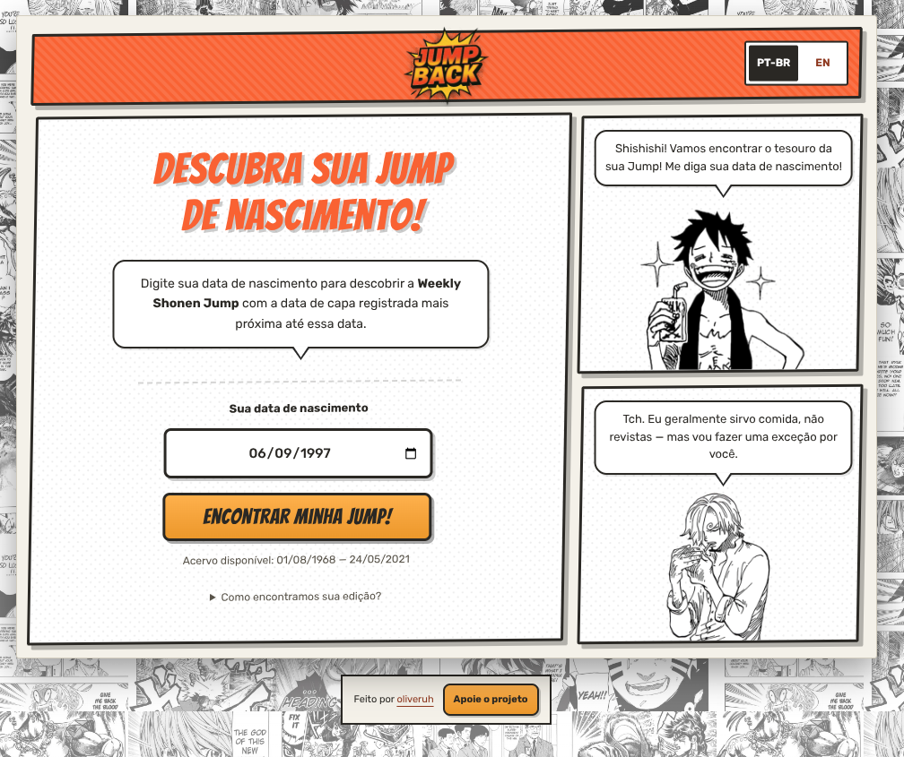
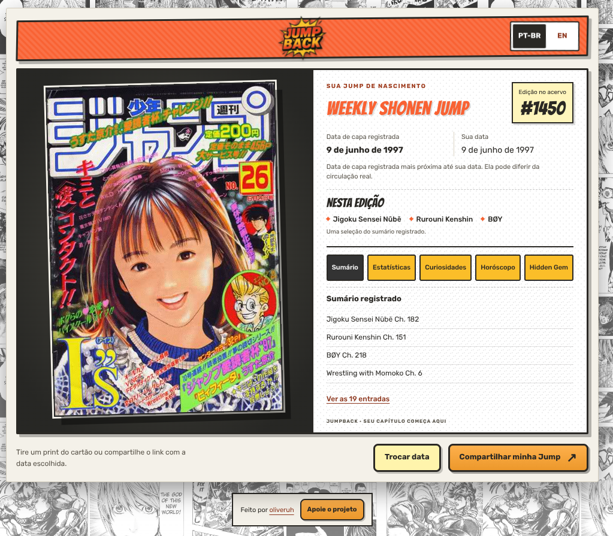

# JumpBack — plano de polimento visual para o evento

Data: 26 de outubro de 2026. Status: proposta 3 escolhida e implementada em PT-BR e EN. Validação registrada em [design-qa.md](../design-qa.md).

## Objetivo e contexto

Fortalecer a identidade de mangá do JumpBack e tornar a experiência atraente para
quem passa pelo estande, clara para quem se aproxima e confortável para quem usa
mouse e teclado. O percurso deve ser evidente: informar a data, descobrir a capa,
explorar a edição e liberar a estação para outra pessoa.

Referência provisória: monitor horizontal Full HD, viewport de 1920 × 1080 e zoom
de 100%. Resolução física, escala do sistema, área útil do navegador, tamanho do
monitor, iluminação e distância precisam ser conferidos na montagem. Também
validar em 1366 × 768 e 1536 × 864. Os tamanhos abaixo são metas de projeto, não
medições realizadas no monitor do evento.

## Ferramentas preparadas antes da análise

| Recurso | Preparação verificada | Uso neste trabalho |
| --- | --- | --- |
| `find-skills` | Instruções carregadas; diretório público de skills consultado | Descoberta de ferramentas adequadas |
| `Product Design/audit` | Skill e contexto verificados; sem contexto persistente anterior | Leitura das capturas e organização dos achados |
| `web-design-guidelines`, Vercel | Instalada em `~/.codex/skills/web-design-guidelines`; fonte original e diretrizes atuais lidas | Revisão de formulários, foco, semântica e estados |
| Referências de `frontend-design` | Tipografia, composição, cor e interação consultadas | Definição da escala e da linguagem visual |
| MCP Firecrawl | Consultas executadas com sucesso | Verificação de fontes primárias e descoberta |
| MCP Figma | Catálogo confirmou plugin instalado e habilitado | Disponível para uma futura prancha editável; nenhum arquivo ou sessão criado |
| Browser integrado | Ferramenta de execução necessária não exposta nesta sessão | Nenhuma auditoria interativa nova foi realizada |

A skill instalada estará disponível para seleção automática no próximo turno;
suas instruções já foram lidas para esta análise. Não foi necessário instalar
outro MCP ou alterar permissões de contas. Figma não é uma dependência do plano.

Fontes de tooling: [skill da Vercel](https://github.com/vercel-labs/agent-skills/tree/main/skills/web-design-guidelines)
e [Web Interface Guidelines](https://github.com/vercel-labs/web-interface-guidelines/blob/main/command.md).

## Evidências e leitura das duas etapas

As imagens abaixo são cópias exatas das capturas fornecidas pelo usuário. A
revisão de código foi restrita às páginas publicadas, ao CSS compartilhado e aos
renderizadores ativos. Os testes relatados em trabalhos anteriores não são
evidência de validação desta proposta visual.

### 1. Entrada e preenchimento — identidade forte; escala e instruções a melhorar

Funcionam bem: título de quadrinhos, personagens reconhecíveis, balões, uma
tarefa principal e botão de busca claramente desenhado como controle.

Oportunidades visíveis na captura:

- O formulário tem menos presença que o título e os personagens. Campo, rótulo e
  explicação precisam ganhar escala e formar um grupo mais coeso.
- A explicação ocupa quatro linhas pequenas. A informação necessária para agir
  pode ser curta; o método de busca já possui uma área própria de detalhes.
- Colagem externa, retícula, sombras e balões disputam atenção em várias camadas.
  O desenho da página pode conservar essa riqueza e oferecer papel mais limpo
  nas áreas de leitura.
- O botão de apoio, no rodapé, recebe um tratamento parecido com ações da tarefa.
  A autoria e o apoio precisam de uma hierarquia secundária consistente.

### 2. Resultado e exploração — capa excelente como foco; leitura muito compacta

Funcionam bem: capa real em destaque, identificação da edição, datas separadas,
cinco abas explícitas e sumário com expansão progressiva.

Oportunidades visíveis na captura e confirmadas no CSS:

- Data e nomes das séries são menores que o selo numérico. O vínculo com o
  nascimento merece um destaque mais forte que o número administrativo do acervo.
- As abas são visíveis, mas a fonte de 11px dificulta sua leitura no contexto do
  monitor. Parte relevante do resultado usa apenas 10–14px.
- Séries destacadas e sumário se sucedem com pouco contraste de hierarquia; há
  espaço para distinguir uma apresentação curta de uma consulta completa.
- O cabeçalho e a largura geral mudam em relação à entrada. A experiência pode
  parecer uma única revista, com a mesma estrutura ao virar de página.
- “Tire um print” e copiar um link têm utilidade limitada em um computador
  compartilhado. O destino pessoal do resultado precisa ser pensado para o evento.

### Achados da avaliação inicial que orientaram o plano

| Origem | Observação | Implicação |
| --- | --- | --- |
| `src/css/reveal.css:49` e `:200` | Entrada limitada a 960px; resultado a 1120px | Um monitor maior não amplia proporcionalmente a experiência; definir uma composição própria para telas largas |
| `src/css/reveal.css:68` e `:202` | Cabeçalhos de 80px e 68px | Unificar dimensões e pontos de referência |
| `src/css/reveal.css:224`, `:231`, `:247`, `:257` | Datas, séries, abas e sumário entre 11 e 14px | Aumentar a escala de informações úteis e reorganizar os espaços |
| `src/br/index.html:36` | Campo de data nativo sem `name` e sem política explícita de autocomplete | Definir identificação do campo e comportamento adequado à estação compartilhada |
| `src/scripts/shared/home.js:13` e `src/scripts/shared/results.js:48` | Retorno preserva a data escolhida | Correção da data e início para outra pessoa precisam de ações distinguíveis |
| `src/css/reveal.css:41` e `src/scripts/shared/results.js:297` | Há estilo de foco e navegação das abas por teclado | Preservar e validar essas capacidades durante o polimento |

Regra confirmada pelo usuário: a entrada PT-BR segue `DD/MM/AAAA` e a entrada EN
segue `MM/DD/YYYY`. A apresentação por extenso no resultado permanece exatamente
como está em cada idioma. O formato visual de um `input type="date"` depende do
locale do navegador; seu valor é ISO. A entrada agora explicita a ordem da página
e converte a data para ISO, sem depender do formato do navegador, preservando a
validação existente. Aceita também oito dígitos e normaliza os separadores.
[Referência MDN](https://developer.mozilla.org/en-US/docs/Web/HTML/Reference/Elements/input/date#value).

## Direção visual: uma revista de mangá que convida a participar

Manter o logo, a faixa laranja, a colagem de páginas, os personagens, os balões,
a dupla Bangers/Rubik, o papel claro, a tinta escura e as sombras deslocadas.
A expansão dessa linguagem deve vir de títulos, faixas, chamadas e quadros com
funções distintas. Inclinações ficam nas molduras e nos detalhes decorativos;
textos, datas e controles mantêm uma base estável de leitura.

O olhar deve encontrar, nesta ordem:

- Na entrada: convite → data → botão de descoberta → personagens.
- No resultado: capa → relação com a data → séries → exploração → próxima ação.

O laranja identifica a marca e a ação principal. O amarelo destaca informação
ou uma ação secundária. Tinta escura identifica leitura e seleção. Retícula e
colagem aparecem com mais força nas bordas e nos espaços livres; textos longos
ganham superfícies claras mais uniformes.

### Escala e tipografia propostas

Tamanhos de referência em pixels CSS com fonte raiz padrão; implementar em
unidades relativas e ajustar por espaço disponível, preservando zoom.

| Papel | Referência Full HD | Tratamento |
| --- | --- | --- |
| Convite da entrada | 72–96px | Bangers, até duas linhas, entrelinha próxima de 1.05 |
| Título principal do resultado | 44–56px | Bangers; mensagem pessoal curta |
| Títulos de seções | 28–32px | Bangers; sem parágrafos nessa fonte |
| Data escolhida e data da capa | 24–30px | Rubik 700, mês por extenso |
| Valor digitado no formulário | 32–40px | Rubik 700, ordem explícita por idioma |
| Texto útil, sumário e balões | 18–20px | Rubik, entrelinha de 1.45–1.6 |
| Abas, rótulos e ações secundárias | 18px | Rubik 500/700 |
| Ação principal da entrada | 28–38px | Bangers; fundo laranja e texto escuro |
| Ajuda, cobertura e explicações | 16px | Rubik; contraste preservado |
| Autoria e detalhes decorativos | 14px | Hierarquia discreta |

Não reduzir textos úteis para encaixar tudo em uma altura fixa. A tela inicial
e o resultado padrão devem caber no viewport de referência; detalhes expandidos
e abas extensas podem usar rolagem normal da página.

### Cor e acabamento

Preservar as cores existentes: papel `#F4F1EA`, tinta `#25231F`, laranja da marca
`#F9622F`, laranja de ação `#FEA42A` e amarelo `#FFE352`. Usar `#8F3519`, já
presente no projeto, para textos pequenos de destaque e links.

Uma verificação pontual dos tokens em fundos sólidos encontrou aproximadamente
3.08:1 para `#F9622F` sobre branco e 7.80:1 para `#8F3519` sobre branco. Portanto,
o laranja claro funciona nos grandes títulos; textos pequenos precisam da
variante escura ou da tinta. Isso não mede todas as combinações sobre retícula.
O critério AA exige 4.5:1 para texto comum e 3:1 para texto grande; esses limiares
não substituem a avaliação física de leitura no evento. [WCAG — contraste](https://www.w3.org/WAI/WCAG22/Understanding/contrast-minimum.html).

Padronizar borda externa de 3px, divisores internos de 1px e uma família de
sombras deslocadas de 4–6px. Usar espaçamentos recorrentes de 8, 12, 16, 24, 32
e 48px. Preservar os cantos e balões atuais, com menos molduras concorrentes
dentro da mesma área.

## Composição das telas

### Entrada

- Ampliar a folha para aproximadamente 1520–1640px no viewport Full HD, com
  margens laterais que ainda revelem a colagem. Validar a mesma largura no resultado.
- Manter a divisão aproximada de dois terços para a busca e um terço para os
  personagens. Fazer o formulário ocupar melhor a área principal.
- Usar cabeçalho comum de aproximadamente 88–96px, logo central mais presente
  e seletor de idioma em posição estável.
- Preservar “Descubra sua Jump de nascimento!” como chamada. Encurtar o balão
  principal para “Digite sua data de nascimento e descubra sua edição.”
- Agrupar rótulo, formato da data, campo, botão e cobertura. Campo e
  botão com largura aproximada de 420–480px e altura de 64–72px em Full HD.
- Exibir uma ajuda discreta de teclado: “Digite a data e pressione Enter”.
- Manter a cobertura do acervo legível e derivada dos dados. Reservar a
  explicação sobre data de capa para “Como encontramos sua edição?”.
- Aumentar o texto dos balões dos personagens; editar diálogos para duas ou
  três linhas curtas. Aproveitar o espaço ganho para ampliar a arte existente.

### Resultado

- Usar uma abertura em duas colunas, aproximadamente 45% para a capa e 55% para
  informações. O aumento da largura favorece principalmente a leitura da coluna direita.
- Preservar a capa inteira, suas proporções e a moldura de papel. Testar altura
  de 580–650px no monitor Full HD, conforme a altura útil do navegador.
- Dar presença à mensagem “Sua Jump de nascimento” e à data de capa. Manter o
  rótulo “Edição no acervo” para o número; não sugerir que é a numeração anual
  impressa na revista nem que a data de capa é a data real de circulação.
- Colocar as duas datas próximas e claramente rotuladas. A ressalva histórica
  continua disponível em texto legível abaixo delas.
- Apresentar até três séries como uma chamada editorial, com fonte maior e
  separação clara. Preservar sua ordem e o caráter de seleção do sumário.
- Identificar as abas com o convite “Explore sua edição”. Aumentar rótulos e
  áreas de clique para cerca de 52–56px de altura, com seleção marcada por
  mais de uma pista visual: fundo, peso e indicador gráfico.
- Manter a prévia de quatro entradas e tornar “Ver as 19 entradas” um controle
  secundário claramente clicável. A lista completa conserva todos os registros.
- Propor o rótulo “Joia escondida” no PT-BR, com “Hidden Gem” como apoio quando
  necessário. Ajustar também a escala dos perfis e gêneros acrescentados recentemente.
- Agrupar ações no fim da folha; alinhar autoria e apoio à mesma composição.

## Interação no evento

O polimento visual prioritário inclui campo legível, ordem de data explícita,
validação próxima ao campo, estados de carregamento e falha claros, navegação
com Tab/Shift+Tab, envio com Enter, setas nas abas e foco visível. A capa e os
extras opcionais não podem bloquear a leitura dos dados.

Manter foco visível e garantir que barras fixas não o cubram. A meta de projeto
é deixar o controle inteiro visível; o critério AA de foco não encoberto exige
que ele não fique totalmente oculto por conteúdo da página. [WCAG — foco](https://www.w3.org/WAI/WCAG22/Understanding/focus-not-obscured-minimum.html).

Duas melhorias funcionais são recomendadas como uma etapa própria, depois da
composição e sem bloquear o polimento:

1. “Próxima pessoa” ou “Começar de novo” abre a entrada vazia e direciona o foco
   ao formulário. “Corrigir data” preserva a escolha atual. Não introduzir
   reinício automático por tempo, que interromperia a exploração.
2. “Levar no celular” pode abrir um QR gerado localmente para o resultado,
   acompanhado do aviso de que o link contém a data escolhida. Compartilhar e
   copiar continuam como alternativas. QR é funcionalidade nova: requer
   implementação e teste de leitura, não apenas a troca do rótulo do botão.

Os estados especiais devem usar a mesma linguagem visual: papel, tinta, frase
curta e próximo passo claro. Evitar animações contínuas; um breve aparecimento
da capa e o feedback dos controles são suficientes. Preservar movimento reduzido.

## Execução e critérios de aprovação

| Ordem | Entrega | Como avaliar |
| --- | --- | --- |
| P0 | Tokens, escala, contraste, folha e cabeçalho comuns | Comparação com estas duas referências; mesma identidade; informação principal legível |
| P1 | Entrada: convite, formulário, balões e data por extenso | Pessoa entende onde começar; digita e envia pelo teclado sem orientação |
| P1 | Resultado: datas, séries, abas e ações | Capa e ligação com o nascimento percebidas primeiro; cinco abas descobertas sem explicação |
| P2 | Fluxo de próxima pessoa e transporte para celular | Nova sessão limpa; correção preserva data; QR real e testado se aprovado no escopo |
| P3 | Revisão no equipamento e ajustes finais | Layout, leitura, foco, reflexos e zoom conferidos no monitor real |

Na implementação, alterar os estilos compartilhados, a estrutura das páginas
publicadas nos dois idiomas e apenas os comportamentos necessários nos módulos
ativos. Preservar os dados históricos, a validação, os fallbacks e a lógica de
correspondência. Os diretórios legados aposentados não entram no fluxo.

Validar o viewport efetivo do evento e os formatos 1920 × 1080, 1536 × 864 e
1366 × 768. Conferir zoom de 125% e 200%, nomes longos, sumário expandido, abas
extensas, falha de capa e estados de erro. Nenhuma rolagem horizontal e nenhum
controle de foco encoberto. Conteúdo longo pode aumentar a altura da página.

Realizar um ensaio com três a cinco pessoas sem explicar o fluxo. Como metas
de avaliação: perceber o convite a cerca de 1.5–2m; compreender o primeiro passo
em aproximadamente três segundos; completar a busca sem ajuda e reconhecer como
explorar ou iniciar outra. Distâncias e tempos são hipóteses a validar no local.

Depois das mudanças, executar a suíte existente e a checagem do catálogo,
acrescentando validação específica apenas para comportamentos novos. Capturar
antes/depois no mesmo viewport e com a mesma edição. Um mockup ou captura não
substitui o ensaio com mouse, teclado e iluminação do evento.

Implementação concluída: proposta 3, assets originais e acento raster de tinta.
O formulário ganhou escala, as datas ficaram destacadas em amarelo e as ações
foram integradas à ficha da edição. Os testes funcionais e a revisão visual
estão em [design-qa.md](../design-qa.md). O próximo passo operacional é conferir
a leitura e o uso no monitor físico durante a montagem do evento.
