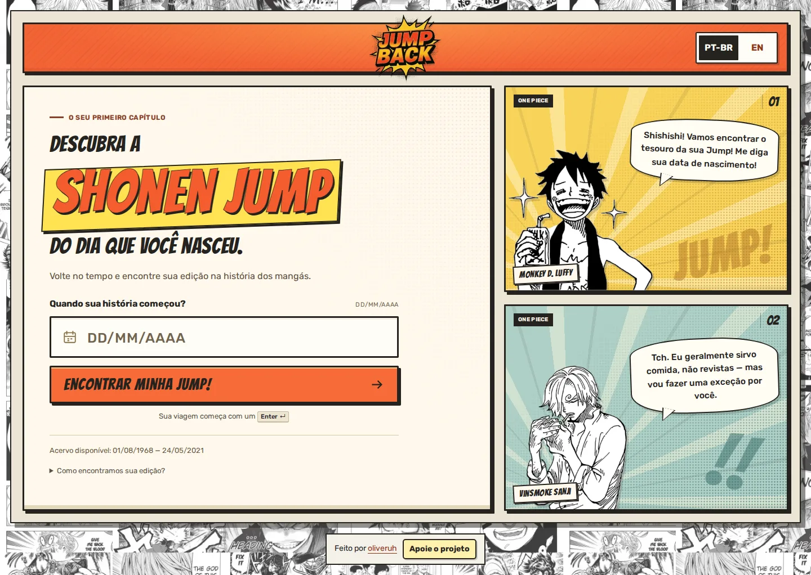
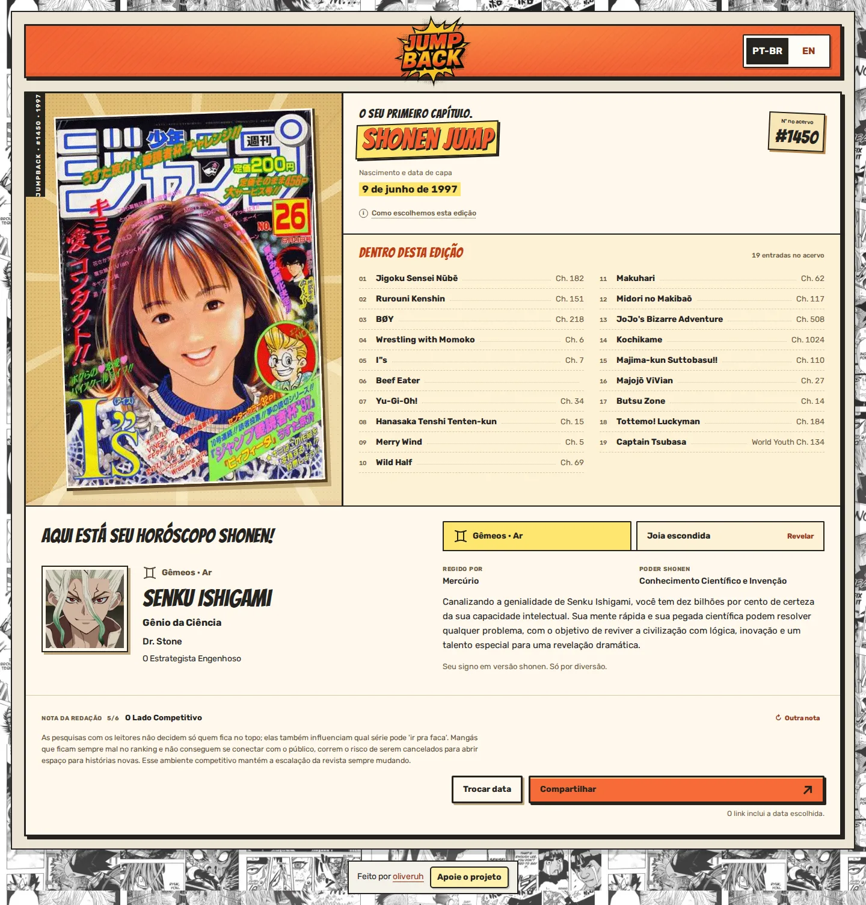

# Polimento de index e results

Revisão de 27 de outubro de 2026, em português brasileiro e inglês.

## Composição

A entrada preserva o papel claro, a faixa laranja, o título de mangá e os dois
quadros de personagens. O campo de data ganhou placeholder com maior contraste,
números de largura uniforme e indicação de erro na própria moldura. A explicação
do acervo tem uma área de toque mais confortável.

O resultado abre com a capa ao lado da identificação e do sumário completo. O
horóscopo continua aberto por padrão, agora em uma faixa abaixo da edição; em
telas largas, o perfil e sua descrição ocupam colunas separadas. A nota da
redação e as ações encerram a folha. As duas páginas compartilham as margens do
cabeçalho e o tratamento do rodapé.

As regras que comprimiam texto e controles em notebooks foram removidas. O
conteúdo usa rolagem vertical normal, sem tentar encaixar o resultado inteiro
em uma tela. No celular, a ordem é ficha, capa, sumário, extras e ações; a reserva
de 120px da antiga barra fixa foi retirada.

## Interação

- Explicação da data abre por clique, Enter ou Espaço, permanece aberta para
  leitura e fecha com Escape ou clique fora.
- O atalho para o conteúdo funciona também durante carregamento e erro.
- “Outra nota” tem área mínima de 44 × 44px e anuncia a nova cópia aos leitores
  de tela, sem anunciar novamente o botão.
- O título dos extras acompanha a alternância entre horóscopo e joia escondida.
- A busca, os formatos de data de cada idioma e os fallbacks de compartilhamento
  e carregamento foram preservados.

## Validação

- `npm test`: 12 testes aprovados.
- `npm run catalog:check`: 2.600 edições e 54 arquivos anuais verificados.
- `npm run test:smoke`: 49 cenários aprovados, sem erros JavaScript ou rolagem
  horizontal. Inclui entrada, validação, idioma, teclado, detalhes, falhas,
  tentativas de recuperação e compartilhamento. Um cenário com animação normal
  também verifica que a explicação da data permanece acima do sumário.
- 32 combinações de página, idioma e viewport: 320×844, 390×844, 768×1024,
  1024×900, 1366×768, 1440×1000, 1920×1080 e 960×540. Sem overflow horizontal;
  capa real carregada nos 16 resultados. O botão da busca permanece visível
  inicialmente nas áreas úteis de altura igual ou superior a 768px.
- Conferências adicionais em PT-BR e EN, a 320px e 1366px: data de nascimento
  diferente da capa, dica aberta, joia escondida e campo inválido.

Capturas de referência usam `1997-06-09`, edição #1450, com o par de personagens
One Piece fixado apenas no script de conferência. As imagens acima são capturas
do Chromium convertidas para WebP; o conteúdo da interface não foi retocado.
Scripts, capturas completas e medidas locais ficam em
`test-artifacts/visual-polish/` (ignorado pelo Git).

O resultado PT-BR mede 1.504px de altura em 1440×1000 e 2.504px em 390×844.
Essas medidas incluem o horóscopo aberto. Esta validação foi realizada em
Chromium; não substitui a conferência física no monitor do evento nem cobre
Safari e Firefox.
